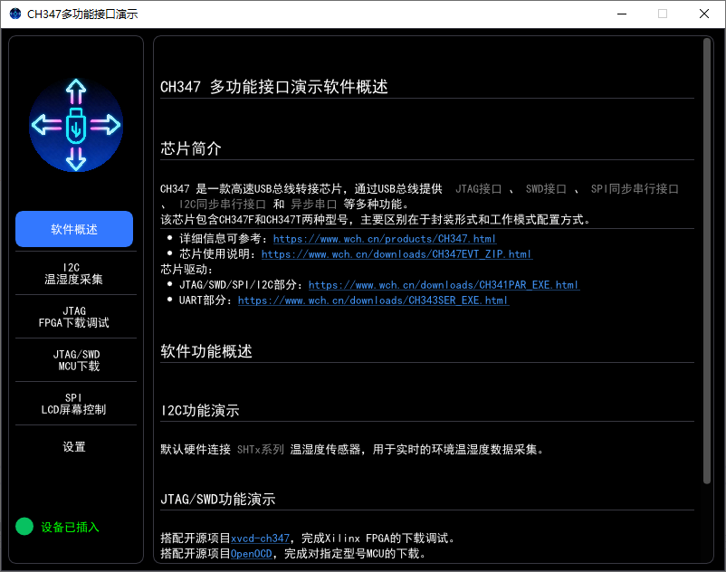
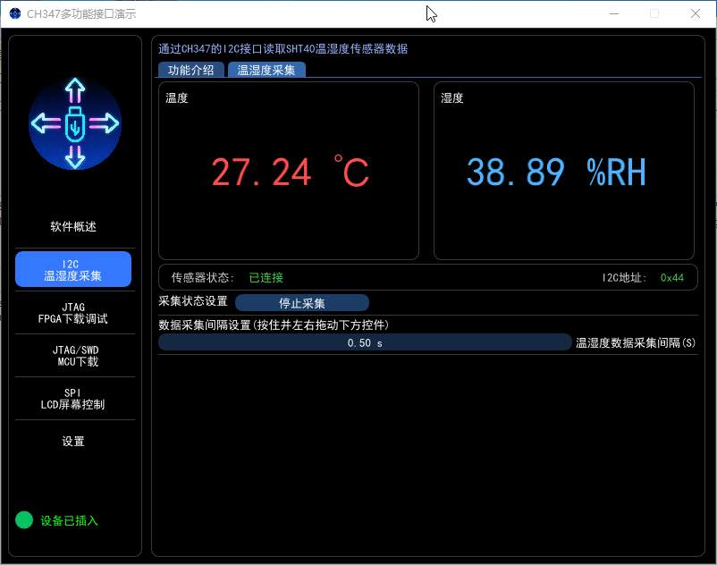
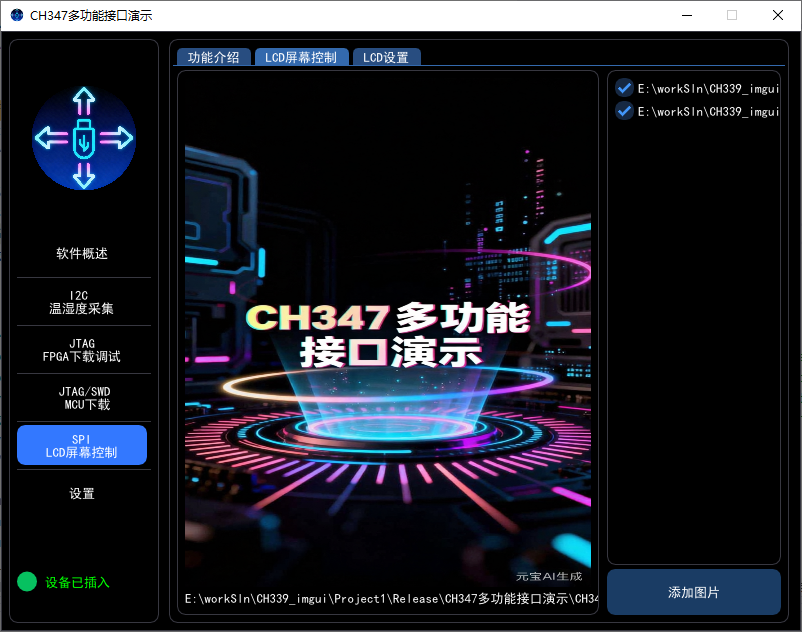

# CH347 多功能接口演示软件

基于 CH347 高速 USB 转接芯片的 Windows 桌面演示工具，使用 Dear ImGui、ImPlot 与 SDL3 构建。仓库包含完整源码、构建脚本所需依赖以及运行 OpenOCD、XVCD 和 TFT 演示所需的资源文件。

详细介绍可参考：

> [https://blog.csdn.net/qq_43010294/article/details/158005191](https://blog.csdn.net/qq_43010294/article/details/158005191)

## 功能

- **I2C 温湿度采集**：读取 SHT2x/SHT3x 系列传感器数据并进行实时显示。
- **JTAG/SWD 调试与下载**：集成 OpenOCD 与 xvcd-ch347，支持 MCU 和 Xilinx FPGA 下载调试。
- **SPI LCD 演示**：面向 ST7789 系列 LCD，支持从本地选择图片并通过 CH347 SPI/GPIO 刷写显示。
- **设备与系统状态**：显示 CH347 设备状态、系统资源占用等信息。
- **内嵌帮助文档**：应用内说明与 `doc/help.pdf` 用户手册。

> FPGA 下载调试与 MCU 下载使用同一组 JTAG/SWD 资源，不能同时运行。

## 软件界面







## 环境要求

- Windows 10/11（程序为 32 位，可在 x64 系统运行）
- Visual Studio 2022，安装“使用 C++ 的桌面开发”工作负载和 Windows 10/11 SDK
- CH347 WCH 驱动及对应硬件

## 构建

1. 使用 Visual Studio 2022 打开根目录的 `CH347-Multi-Function-Interface-Demo.sln`。
2. 选择 `Release | x86`。仓库内的 CH347 SDK 当前仅提供 32 位库，因此请使用 x86/Win32 配置。
3. 执行“生成解决方案”。

SDL3、SDL3_image、CH347 SDK 和其余源码依赖均已随仓库提供。生成完成后，MSBuild 会自动把 `res`、`TFT_Picture`、`doc`、`OpenOCD_CH347`、`CH347_XVCD_GUI` 及运行所需的 DLL 复制到输出目录。

默认输出：

```text
x86\Release\CH347多功能接口演示.exe
```

请从输出目录启动程序，应用使用相对于当前工作目录的路径查找图标、图片、配置、OpenOCD 和 XVCD 资源。

## 目录结构

```text
.
├─ CH347-Multi-Function-Interface-Demo.sln   # Visual Studio 解决方案
├─ Project1/Project1/                         # 应用源码、资源和内置工具
│  ├─ main.cpp                                # 程序入口与界面
│  ├─ ch3xx.hpp / sys_monitor.hpp             # CH347 与系统状态
│  ├─ openocd.hpp / xvcd.hpp                  # OpenOCD、XVCD 集成
│  ├─ TFTSceen.hpp                            # ST7789 LCD 演示
│  ├─ res/ / TFT_Picture/ / doc/              # 运行资源与文档
│  ├─ OpenOCD_CH347/                          # OpenOCD 0.12.0 CH347 构建
│  └─ CH347_XVCD_GUI/                         # xvcd-ch347 工具
├─ SDL3/                                      # SDL3/SDL3_image 头文件、导入库和 DLL
├─ LICENSE                                    # 项目许可证
└─ THIRD_PARTY_NOTICES.md                     # 第三方组件说明
```

`Cfg.INI`、`imgui.ini`、Visual Studio 缓存和构建产物均为本机生成文件，不纳入版本控制。

## 第三方组件

主要组件包括 Dear ImGui、ImPlot、imgui_markdown、stb、SimpleIni、SDL3、SDL3_image、OpenOCD、xvcd-ch347 和 WCH CH347 SDK。版本、许可证与上游地址见 [THIRD_PARTY_NOTICES.md](THIRD_PARTY_NOTICES.md)。

## 许可证

本项目代码遵循根目录 [LICENSE](LICENSE) 中的 MIT 许可证；第三方组件继续遵循各自许可证。
